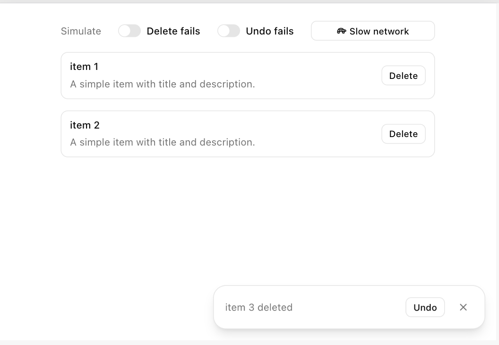

# action-lifecycle



I couldn't find a reusable module for an undo-able action with lifecycle management. This is a small one. It is a controller that runs an async action, keeps an undo window open, and reverts it if asked.

Although it is presented with a React hook, the controller itself is framework-independent.

There's no UI - render the state with whatever toast component you use. This demo uses shadcn/ui and tailwind.

## Usage

```tsx
import { useUndoableAction } from "action-lifecycle";

const { state, execute, undo, dismiss } = useUndoableAction({
  execute: doAction,
  undo: reverseAction,
  duration: 5000,
  onSuccess,
  onUndo,
  onError,
});

execute(arg);
```

Render your own toast from `state.status`.

### Options

| Option      | Type                              | Description                                                     |
| ----------- | --------------------------------- | --------------------------------------------------------------- |
| `execute`   | `(arg) => Promise`                | The action. Must reject on failure.                             |
| `undo`      | `(arg) => Promise`                | Its reverse, called with the same `arg`.                        |
| `duration`  | `number`                          | Undo window in ms. Default `5000`.                              |
| `onSuccess` | `(arg) => void`                   | Called after `execute` resolves.                                |
| `onUndo`    | `(arg) => void`                   | Called after `undo` resolves.                                   |
| `onError`   | `(error, { phase, arg }) => void` | Called when either rejects. `phase` is `"execute"` or `"undo"`. |

`undo` reverses an action that has already happened, so your backend needs a reverse operation (eg. restoring a soft deleted row). Actions that can't be taken back like sending an email need wait, then-send instead.

### Returns

| Value          | Description                                                    |
| -------------- | -------------------------------------------------------------- |
| `state`        | Current state, see [States](#states).                          |
| `execute(arg)` | Runs the action. Ignored while one is in flight.               |
| `undo()`       | Runs the reverse. Only valid while `undoable` or `undoFailed`. |
| `dismiss()`    | Closes the undo window early.                                  |

## Behavior

- **Pessimistic.** The undo window opens only after `execute` resolves. A failure never shows as success.
- **One action at a time.** A new `execute` finalizes the previous action and closes its window. Old timers and late results are ignored.
- **Duplicate calls are ignored** while an action or undo is in flight.
- **Failed undo can be retried** until the original deadline.

## States

```
idle
 │ execute()
 ▼
executing ───── fails ──────► executeFailed
 │ succeeds
 ▼
undoable ────┬─ time's up ──► expired
 │ undo()    └─ dismiss() ──► dismissed
 ▼
undoing ─────── succeeds ───► undone
 │ fails
 ▼
undoFailed ──┬─ time's up ──► expired
             ├─ dismiss() ──► dismissed
             └─ undo() ─────► undoing (retry)
```

The framework-independent core is exported as `UndoableActionController`.

## Development

```bash
pnpm install
pnpm --filter api dev                 # demo API, :3000
pnpm --filter demo dev                # demo app, :5173
pnpm --filter action-lifecycle test
```

The demo has switches to make delete or undo fail and to slow the network to 3s.
